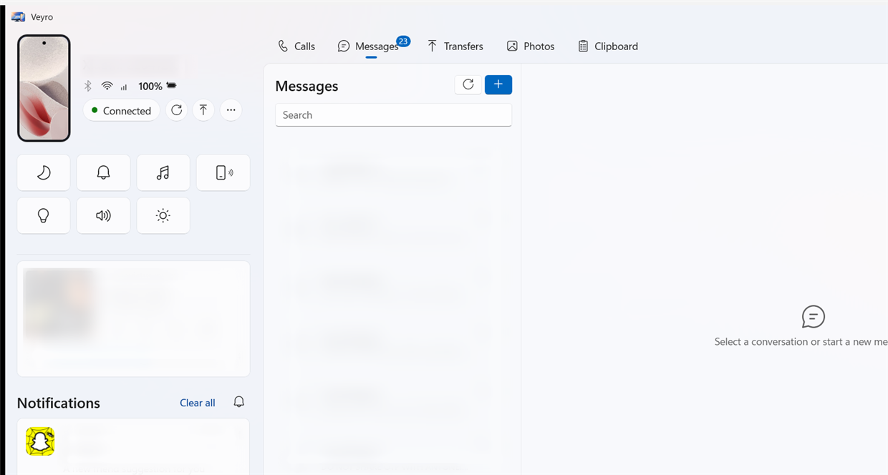
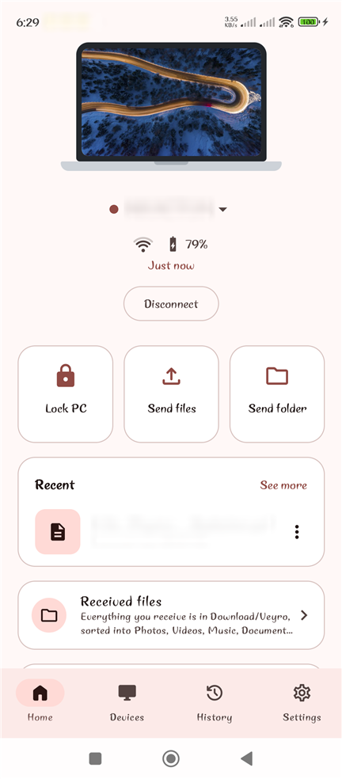
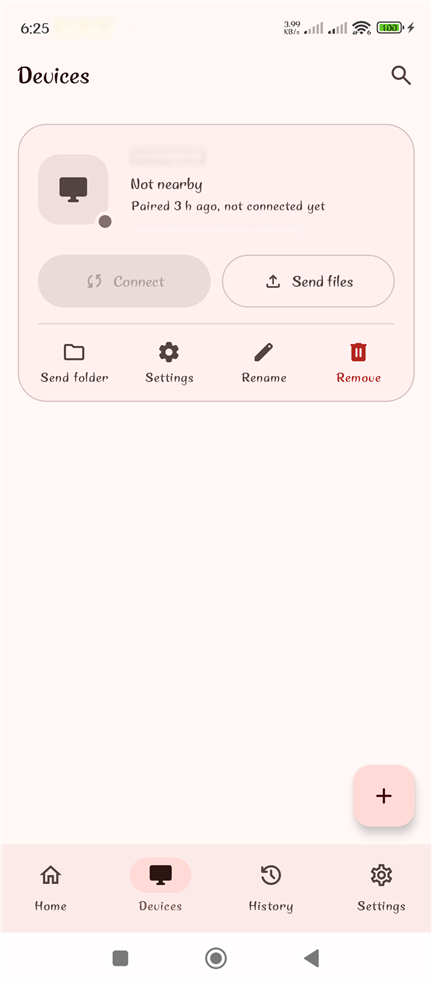
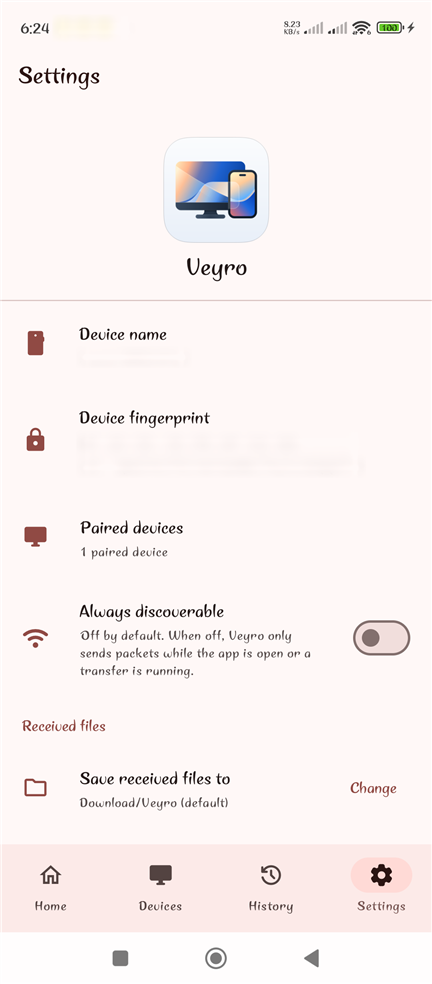

# Veyro

**Seamlessly connected.** Your Android phone and your Windows PC working as one: files, clipboard,
notifications, messages, calls and media, over Wi-Fi, LAN or a hotspot. No Bluetooth requirement,
no cloud, no account.



<p align="center">
  
  
  
</p>

<sub>Personal data (names, messages, notifications, file names, fingerprints) is blurred in these screenshots.</sub>

## Features

- **Files and folders** both ways, with per-file SHA-256 verification and resume.
- **Clipboard** sharing, text and images.
- **Notifications** from the phone on the PC, with dismiss.
- **Messages (SMS)**: read and send from the PC.
- **Calls** through the PC over Bluetooth, with a call window.
- **Photos** from the phone, browsable on the PC.
- **Media**: see and control what the phone plays.
- **Phone controls** from the PC: Do Not Disturb, ringer mode, find my phone, flashlight,
  media volume and brightness.
- **Lock PC** from the phone.
- **Islune dynamic island** (optional): phone status, quick controls and drag-to-send on the
  Windows desktop through a local bridge.

## Why

Quick Share works well, but its discovery path involves Bluetooth/BLE, so you end up enabling a
radio that the transfer will not even use. Veyro makes IP the only required path: if the two
devices share a network (router, Android hotspot, or Windows Mobile Hotspot) they find each
other and transfer, with Bluetooth off.

## Properties

| | |
|---|---|
| **Discovery** | mDNS/DNS-SD `_veyro._tcp` + UDP beacon fallback. No Bluetooth, no location permission. |
| **Security** | X25519 identities, confirm-code or QR pairing. Every command, notification, message and call event is encrypted and authenticated. File contents travel unencrypted on the local network for maximum speed, authenticated per transfer and SHA-256 verified. |
| **Integrity** | Per-file SHA-256 verification, atomic commit, resume that re-verifies on-disk chunks. |
| **Idle cost** | No background scanning, no beacons, no wakelocks when idle. Discovery runs only in a bounded, user-initiated window. |
| **Diagnosis** | AP client isolation, blocked multicast, VPN interference and firewall blocks are detected and named, never a generic "device not found". |
| **Privacy** | No cloud, no account, no telemetry. Display name hidden outside pairing mode. |

## Install

Download the latest files from [Releases](https://github.com/InvictusVerse/veyro/releases).

- **Windows 11 (x64):** run `Veyro-Setup-<version>.exe`. It installs the Windows App Runtime and
  Veyro's publisher certificate. The setup is self-signed, so Windows SmartScreen shows
  "unknown publisher"; check the SHA-256 against the `.sha256` file before you run it.
- **Android 10 or later:** install `Veyro-<version>.apk` (allow installs from your browser or
  file manager when asked).

Open Veyro on both devices on the same network and pair them with the code or QR shown.

## Repository layout

```
veyro/
├─ docs/screenshots/   Images used by this README.
├─ protocol/           Language-neutral protocol schema (CDDL) + interop test vectors,
│                      shared by the Android and Windows implementations.
├─ tools/              Helper scripts.
├─ VeyroAndroid/       Android client: Kotlin, Jetpack Compose, multi-module.
└─ VeyroWindows/       Windows client: .NET 10, WinUI 3, packaged as MSIX.
```

## Build

Android:

```powershell
cd VeyroAndroid
.\gradlew.bat assembleDebug
.\gradlew.bat test
```

Windows:

```powershell
cd VeyroWindows\src
dotnet build Veyro\Veyro.csproj -c Debug -p:Platform=x64
dotnet test Veyro.Tests
```

## License

GPL-3.0, see [`LICENSE`](LICENSE).
